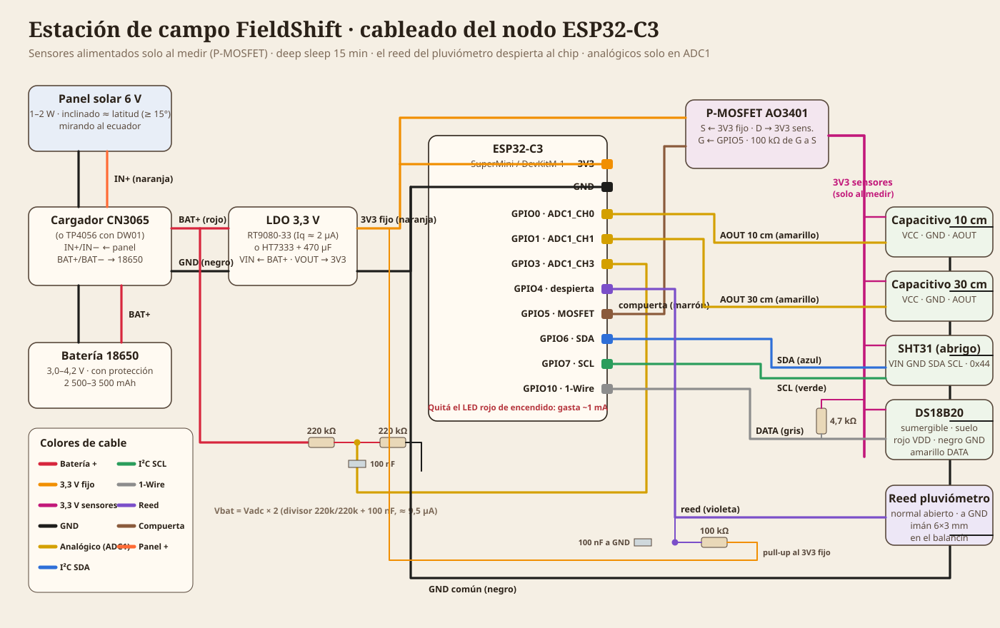

# Estación de campo FieldShift (sensor de humedad del suelo + lluvia)

Prototipo para tener **datos medidos** del terreno como respaldo del modelo:

- **¿Hay que regar hoy?** Humedad a 10 y 30 cm → % del agua disponible en la zona de raíces → "regá Z mm (W litros)" o "no regués".
- **¿Llovió hoy y a qué hora?** Pluviómetro de balancín: cada golpe queda con su hora → "llovió 18 mm a las 15:20 (duró 45 min, hasta 34 mm/h)".
- **¿Llovió sin estar pronosticado?** Se compara con lo que pronosticaba Open-Meteo el día anterior → "llovió 18 mm sin estar pronosticado (el pronóstico decía 0,4 mm). No regués hoy: el suelo está al 57 %".
- **Pronosticar mejor**: campo reemplaza el agua del modelo por la observada (`UltimoEstado`) y re-asimila cada día.

Hardware y modelos: [`hardware/README.md`](../hardware/README.md). Diagrama: [`hardware/diagrama/index.html`](../hardware/diagrama/index.html).



---

## 1. Electrónica

| Bloque | Pieza | Por qué |
|---|---|---|
| Nodo | **ESP32-C3** (SuperMini o DevKitM-1) | deep sleep de pocos µA, WiFi, 5 ADC1. Alternativas con la tabla de pines: ESP32-S3 y ESP32 clásico |
| Humedad | 2 × **capacitivos** v1.2/v2.0 a 10 y 30 cm | no tienen electrodos expuestos: no se corroen |
| Suelo | DS18B20 sumergible | temperatura del suelo a 10 cm (germinación, corrige la lectura capacitiva) |
| Aire | SHT31 (o BME280) en el abrigo de platos | temperatura y humedad del aire sin sol directo |
| Lluvia | pluviómetro de balancín impreso + reed + imán 6×3 | mm y hora de cada golpe; despierta al chip por interrupción |
| Energía | 18650 con protección + CN3065 (o TP4056 con DW01) + panel 6 V 1–2 W + LDO RT9080-33 | Iq ≈ 2 µA; el LDO de la placa SuperMini gasta más |
| Batería | divisor 220 k/220 k + 100 nF a ADC1 | Vbat/2, ≈ 9,5 µA |
| Encendido | P-MOSFET AO3401 (compuerta en GPIO5, 100 k G–S) | los sensores solo consumen los ~0,6 s de la medición |

**Pines** (todo lo analógico en ADC1 porque ADC2 no funciona con WiFi; el reed en un pin que despierta del deep sleep):

| Función | ESP32-C3 | ESP32-S3 | ESP32 (D) |
|---|---|---|---|
| Humedad 10 cm | GPIO0 (ADC1_CH0) | GPIO1 | GPIO32 |
| Humedad 30 cm | GPIO1 (ADC1_CH1) | GPIO2 | GPIO33 |
| Batería | GPIO3 (ADC1_CH3) | GPIO4 | GPIO35 |
| Reed (despierta) | GPIO4 (GPIO0–5 despiertan en el C3) | GPIO5 (ext0) | GPIO34 (ext0) |
| P-MOSFET | GPIO5 | GPIO6 | GPIO25 |
| I²C SDA/SCL | GPIO6/7 | GPIO8/9 | GPIO21/22 |
| DS18B20 | GPIO10 | GPIO7 | GPIO4 |

Pines de arranque que no se usan para sensores: C3 GPIO2/8/9 · S3 GPIO0/3/45/46 · ESP32 GPIO0/2/12/15.

### Si los sensores del dueño son resistivos (dos patas de metal, módulo YL-69/FC-28)

No conviene dejarlos en el suelo: con corriente continua los electrodos se **electrolizan** (el ánodo se disuelve en semanas), la lectura deriva y depende mucho de la sal del suelo y del abono. Si hay que usarlos:

1. alimentarlos **solo al medir** desde la línea conmutada por el MOSFET (o un GPIO, consumen < 10 mA);
2. medir a los ~100 ms y apagar enseguida (el firmware ya lo hace: los sensores se encienden ~0,4 s cada 15 min);
3. calibrar seco/mojado igual que los capacitivos y revisar la calibración cada mes;
4. cambiarlos por capacitivos en cuanto se pueda.

## 2. Modelos 3D (OpenSCAD paramétrico)

Carpeta `hardware/3d/`: `.scad` editables, `stl/`, `3mf/` y `render/`. Exportar todo y chequear interferencias: `bash hardware/3d/exportar.sh`.

| Pieza | Archivo | Material | Orientación / soportes |
|---|---|---|---|
| Caja estanca (base, tapa, junta) | `caja.scad` | PETG/ASA; junta en **TPU 95A** | base boca arriba, tapa con la cara exterior en la cama, sin soportes |
| Soporte del panel (bandeja + 2 orejas) | `soporte_panel.scad` | PETG/ASA | planos, sin soportes |
| Abrigo de platos (base, 6 platos, techo) | `abrigo.scad` | **ASA o PETG blanco** | cada plato con el ala en la cama, sin soportes |
| Pluviómetro (embudo, base, balancín) | `pluviometro.scad` | PETG/ASA | embudo boca abajo (filo en la cama), balancín de costado, sin soportes |
| Abrazaderas y estaca para tubo PVC | `abrazadera.scad` | PETG/ASA | mitades de canto, estaca de pie |
| Protector del sensor capacitivo | `protector.scad` | PETG | de pie, sin soportes |

- **No PLA**: a pleno sol se ablanda (~55–60 °C) y se deforma.
- Boquilla 0,4 mm, capas 0,2 mm, 4 perímetros (7 en la caja), relleno 25 %.
- Tolerancias de encastre 0,25 mm (eje del balancín 0,30 mm). Cambiá `tol` en `comun.scad` si tu impresora aprieta o afloja.
- Tubo: `tubo_d = 21.3` (½") o `26.7` (¾") en `comun.scad`. Inclinación del panel: `latitud` en `soporte_panel.scad` (sugiere `max(15, |latitud|)`).
- **Chequeo de interferencias** (`chequeo.scad`, 15 casos: tapa/base, junta/base, balancín nivelado y volcado ±22° contra la base y los topes, embudo/base, embudo/balancín, platos entre sí, abrazadera/tubo, mitades de la abrazadera, estaca/tubo, protectores/placa del sensor): cada intersección tiene que dar vacía.

### Pluviómetro: cuánto vale un golpe

Boca de **100,0 mm** → área = π·50² = **7 854 mm²**. Cada golpe vacía una cubeta; con 1,571 mL por golpe:

  mm por golpe = 1 571 mm³ / 7 854 mm² = **0,20 mm**

El volumen real depende de los topes (tornillos M3 en insertos: más alto el tornillo, menos inclinación, menos volumen). **Calibración**: con el pluviómetro nivelado (nivel de burbuja en la base), verter despacio 157 mL con una jeringa o botella con agujerito (= 20 mm de lluvia, en ~10 min) y contar los golpes:

  mm_golpe = 20 / golpes   (o: volumen_mL × 1000 / 7 854 / golpes)

Ajustar los topes hasta ~100 golpes (0,20 mm) y repetir 3 veces. El valor final se carga en el portal de la estación y en el servidor (`PATCH /api/sensores/{id}` `{"mm_golpe": 0.2}`).

## 3. Firmware (`hardware/firmware`, PlatformIO + Arduino)

```
pip install platformio
cd hardware/firmware
pio run -e esp32c3            # o esp32s3 / esp32dev
pio run -e esp32c3 -t upload
pio device monitor -b 115200
```

Compila sin errores para **esp32c3, esp32s3 y esp32dev**.

- **Ciclo**: despierta cada 15 min (alineado al cuarto de hora), enciende los sensores con el MOSFET, espera 0,4 s, lee 21 muestras por canal y promedia las 11 del medio (promedio recortado), aplica un filtro exponencial (α = 0,6) entre mediciones, lee el DS18B20 (10 bits) y el SHT31, apaga los sensores, guarda en la memoria RTC y transmite.
- **Pluviómetro**: el reed despierta al chip (GPIO4 en el C3, `esp_deep_sleep_enable_gpio_wakeup`; ext0 en S3/ESP32), se anota la hora del golpe en RTC (300 golpes; después a LittleFS) y vuelve a dormir sin encender WiFi. Antirrebote 250 ms por software + RC de 10 ms. Si el balancín queda trabado con el imán frente al reed, no se arma el despertar por lluvia hasta la próxima medición (sin bucle de reinicios).
- **Hora**: NTP (pool.ntp.org) una vez por día; el RTC del chip sigue contando en deep sleep. Si nunca hubo hora, las mediciones se mandan con `edad_s` y el servidor las fecha; la hora del encabezado `Date` de la respuesta también sincroniza. Las marcas tomadas sin hora se corrigen al sincronizar.
- **Búfer**: 48 mediciones en RTC (12 h) y después LittleFS (`/buf.bin`); al volver la red se mandan de a 96. Un reenvío no duplica (el servidor ignora lecturas repetidas).
- **Envío**: `POST {servidor}/api/sensores/{id}/lecturas`, `Authorization: Bearer {token}`. 202 = guardado; 401 = token malo (deja de reintentar hasta reconfigurar).
- **HTTPS**: si existe `/ca.pem` en LittleFS valida el certificado (para Let's Encrypt: ISRG Root X1 de letsencrypt.org/certs, copiarlo a `hardware/firmware/data/ca.pem` y `pio run -t uploadfs`). Sin ese archivo cifra pero **no verifica** el certificado (aviso en el monitor).
- **Batería**: con menos de 3,55 V transmite cada hora (siempre si hubo lluvia).
- **Configuración**: portal WiFi "FieldShift-Estacion" (WiFiManager) la primera vez o con **doble reset** (RESET dos veces en 3 s): red, servidor, ID del dispositivo, token, ID de la parcela, puntos de calibración y mm por golpe. Muestra la lectura actual de los dos sensores para calibrar ahí mismo.

### Calibración de los sensores de humedad

1. Sacar ~1 L de suelo del lugar, sin piedras.
2. **Seco**: secarlo al sol 2–3 días (o al horno a 105 °C), llenar un vaso y enterrar el sensor hasta la línea blanca. En el monitor serie escribir `seco10` (o `seco30` con el otro sensor); o anotar la lectura que muestra el portal.
3. **Mojado**: agregar agua hasta que quede una lámina encima (saturado), esperar 10 min, escribir `moj10` / `moj30`.
4. `ver` muestra los dos puntos y el índice actual.

El servidor convierte ese índice (0 = seco, 1 = saturado) a humedad volumétrica con la textura del suelo: seco ≈ ½ del punto de marchitez, saturado ≈ θS de Saxton & Rawls (2006). Eso queda marcado **"calibración supuesta"**. Para una calibración **medida**: pesar una muestra del vaso húmeda y seca al horno, calcular θ de cada punto y cargarlos con `PATCH /api/sensores/{id}` `{"calib10": {"theta_seco": 0.05, "theta_mojado": 0.44, "medida": true}}`.

## 4. Servidor (`internal/sensores`)

| Ruta | Quién | Qué |
|---|---|---|
| `POST /api/sensores` `{parcela_id, nombre?, placa?, mm_golpe?, calib10?, calib30?}` | usuario | alta: 201 `{dispositivo, token, ingesta}` (el token se ve una vez) |
| `GET /api/sensores?parcela=ID` | usuario | dispositivos + `estado` + `serie` (72 h) del más reciente |
| `GET /api/sensores/{id}/estado` · `/serie?horas=72` | usuario | estado / serie horaria |
| `PATCH` · `DELETE /api/sensores/{id}` | usuario | mm por golpe, calibración, nombre / baja |
| `POST /api/sensores/{id}/lecturas` | equipo (Bearer) | ingesta: 202 `{guardadas, golpes, descartadas, intervalo_s, mm_golpe, estado}` · 401 |
| `GET /api/sensores/demo?escenario=lluvia\|secado` | público | estación **simulada** (marcada) para la demo |

- **SQLite** (`SENSORES_DB`, por defecto `sensores.db` junto a `DB_PATH`): dispositivos (hash SHA-256 del token), lecturas, golpes y el pronóstico del día guardado en la primera ingesta.
- **Conversión**: textura del punto (sitio del motor: SoilGrids 250 m) → capacidad de campo, punto de marchitez y saturación (Saxton & Rawls 2006) → fracción de agua disponible por capa → zona de raíces (la capa de 10 cm representa 0–20 cm; la de 30 cm, el resto hasta Zr de FAO-56 tabla 22) → agotamiento Dr en mm.
- **Eventos**: `lluvia` (episodios: golpes a menos de 1 h), `lluvia_sorpresa` (≥ 5 mm observados y el pronóstico decía < 2 mm, o el doble y 10 mm más), `regar` (agua < 1 − p de FAO-56: lámina neta hasta capacidad de campo, máx. 35 mm por riego, ÷ eficiencia del método → mm y litros para el área), `no_regar`, `exceso`, `bateria`, `sin_datos` (> 3 h: el riego vuelve al modelo).
- **Pronóstico**: Open-Meteo Previous Runs API (`precipitation_previous_day1`: lo que el modelo decía el día anterior, que no se contamina con la lluvia ya caída); si falla, el pronóstico diario.

### Simulador (demo y pruebas)

```
go run ./hardware/simulador -url http://127.0.0.1:8225 -parcela demo -escenario lluvia   # 18 mm hoy, no pronosticados
go run ./hardware/simulador -url http://127.0.0.1:8225 -parcela demo -escenario secado   # 6 días secándose → regar
go run ./hardware/simulador -url http://127.0.0.1:8225 -parcela demo -token-malo          # 401
```

### Tarjeta web

`web/src/features/sensores/TarjetaSensor.vue` (props `parcelaId`, `demo`, `escenario`): agua a 10 y 30 cm, lluvia de hoy y por hora, batería, último dato, eventos, serie de 72 h y **observado vs modelo** (con `GET /api/parcelas/{id}/hoy` de campo). Vista de desarrollo: `/src/features/sensores/vista.html`.

## 5. Armado paso a paso

1. **Imprimir** todas las piezas (tabla de arriba). Colocar los insertos M3 con el soldador a 220 °C.
2. **Placa**: en la perforada de 5×7 cm soldar el ESP32-C3, el LDO con sus capacitores, el AO3401 con la de 100 k, el divisor de batería y los conectores (borneras o JST) de cada sensor, siguiendo el diagrama y los colores. Quitar el LED rojo de encendido de la SuperMini (~1 mA).
3. **Energía**: panel → CN3065 IN; CN3065 BAT → 18650 (cuna de la caja, con precinto) → LDO → 3V3 del ESP32 (no usar el pin 5V).
4. **Sensores**: sellar los bordes cortados de los capacitivos con barniz o epoxi, poner el **protector** en la electrónica y llenarlo de silicona; pasar cada cable por un **PG7** del fondo de la caja.
5. **Pluviómetro**: reed en el canal de la base (cable por el piso), imán en el brazo del balancín con una gota de cianoacrilato, eje de 2 mm a presión en los postes; probar con un multímetro que el reed cierre **solo al pasar** por el medio (calzar con cinta si cierra en reposo). Calibrar (sección 2).
6. **Firmware**: subirlo, calibrar los sensores en un vaso, dar de alta el dispositivo en la web (o con `POST /api/sensores`) y cargar ID y token en el portal.
7. **Cerrar** la caja con la junta de TPU y una bolsita de sílica gel; el respiradero va en el quinto agujero.

Renders: `hardware/3d/render/*_armado.png` y cada pieza en `hardware/3d/render/`.

## 6. Instalación en el campo

- **Profundidades**: un sensor con el centro de la zona sensible a **10 cm** y otro a **30 cm**, verticales, en la fila del cultivo a 10–15 cm de la planta (donde están las raíces) y donde el riego moja igual que el resto. Abrir el hoyo con un tubo más fino, meter el sensor y apretar la tierra para que no queden huecos de aire (el aire falsea la lectura). El DS18B20 a 10 cm.
- **Pluviómetro**: boca horizontal (nivel de burbuja) a ~1 m del suelo, **lejos de goteras** de techos y árboles: a una distancia de al menos 2 veces la altura del obstáculo (OMM, Guía de instrumentos y métodos de observación, OMM-N° 8, cap. 6).
- **Abrigo**: a 1,25–2 m sobre suelo con pasto (OMM-N° 8, cap. 2), en un brazo de 30–50 cm del tubo, no encima de la caja.
- **Panel**: mirando al ecuador (al **sur** en Guatemala), inclinado ≈ la latitud y nunca menos de 15° (se limpia con la lluvia), sin sombra entre las 9 y las 15 h.
- La caja con los prensaestopas **hacia abajo**. Tubo PVC de 1,5 m clavado con la estaca impresa o enterrado 40 cm.

## 7. Conectividad sin WiFi en el campo

- **Prototipo**: WiFi de la casa o del teléfono (≈ 50–100 m con línea de vista).
- **ESP-NOW** (sin router, ~200 m con línea de vista y antena de la placa): la estación manda el mismo JSON a un **ESP32-S3 puerta de enlace** en la casa (`esp_now_send`, 250 bytes por paquete: una medición por paquete; los golpes en paquetes aparte) y la puerta de enlace hace el `POST` por WiFi. La estación tiene que usar el mismo canal WiFi que el router de la casa. *Documentado, no implementado en esta versión.*
- **LoRa** (SX1276/SX1262 a 915 MHz en América, 1–5 km): módulo en SPI (C3: GPIO 6/7 pasan a SPI y el I²C se mueve; S3 tiene pines de sobra), misma puerta de enlace S3 con otro módulo LoRa. *Documentado, no implementado.*

## 8. Consumo (estimado, sin medir todavía)

| Estado | Corriente | Tiempo |
|---|---|---|
| Deep sleep: C3 (~5 µA según Espressif) + RT9080 (2 µA) + divisor (9,5 µA) + CN3065 en reposo | ≈ 20 µA | casi todo el tiempo |
| Medición + WiFi + HTTPS | ≈ 80–120 mA | 5–12 s cada 15 min |
| Golpe del pluviómetro | ≈ 20 mA | 40 ms |

Promedio ≈ 1–1,5 mA → ≈ 25–35 mAh por día. Una 18650 de 3 000 mAh alcanza para **2–3 meses sin sol**; un panel de 1 W con 4 h de sol útil repone varias veces el consumo del día. Medir con un multímetro en serie antes de dejarla en el campo.

## 9. Costo

No se pone un costo sin una cotización con fuente. La lista de materiales con cantidades está en `hardware/diagrama/index.html` y la lista de compras (lo que falta además de lo que ya tiene el dueño) en el estado del agente.

## 10. Limitaciones

- La calibración por defecto es **supuesta** (seco ≈ ½ PMP, saturado ≈ θS); el error puede ser de ±0,05 m³/m³ hasta calibrar con muestras pesadas.
- Los capacitivos baratos varían entre unidades y con la temperatura; la sal del suelo también los mueve. El DS18B20 permite corregir por temperatura más adelante.
- Dos profundidades representan un punto del terreno; parcelas grandes o con pendiente necesitan más de una estación.
- El pluviómetro subestima con lluvias muy intensas (> 100 mm/h, el balancín no alcanza a vaciar) y con viento fuerte.
- Sin `/ca.pem` el TLS no verifica el certificado del servidor.
- Las alertas de "lluvia sorpresa" dependen de que Open-Meteo responda; sin pronóstico guardado no se emiten.
- ESP-NOW y LoRa están documentados pero no implementados.
- Todo lo que sale del simulador o de `/api/sensores/demo` es **simulado** y va marcado.
