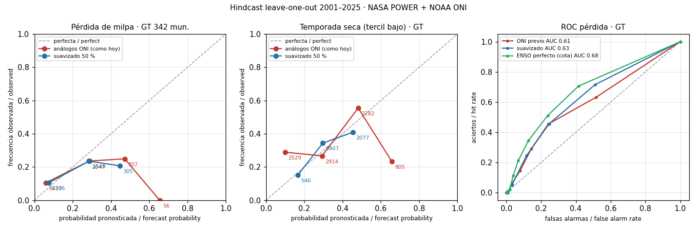

# Validación del escenario «pronostico»: ¿con qué precisión acierta?

> Generado por `go run ./cmd/validar` (agente validacion, 14-nov-2026). Datos: NASA POWER diario 2001–2025 (community AG) y NOAA CPC ONI (ERSSTv5). Salida: `web/public/static/validacion/habilidad.json` y `confiabilidad.png`.

## Respuesta corta (honesta)

- **Guatemala, 342 municipios × 25 años:** el método de años análogos por ONI acertó el **tercil de lluvia de la temporada (may–oct) en el 40 % de los casos** (IC 90 % 32–49 %; el azar da 33 %). **A nivel país no se distingue del azar.** Como probabilidad sale **peor que la climatología** (RPSS −0.10; Brier de pérdida 0.129 vs 0.119).
- **Sí supera al azar en el oriente / Corredor Seco:** **Chiquimula 65 %** (IC 52–78 %), **Jalapa 52 %** y **Jutiapa 47 %**; en el occidente, Retalhuleu 60 % y Quetzaltenango 46 %. Coincide con las celdas donde el ONI ya observado en mar–may (MAM) se correlaciona con la lluvia de la temporada (r ≈ −0.45).
- **En el resto (Altiplano, Verapaces, Petén, Izabal, Escuintla…) no supera al azar.** Ahí el ONI de primavera dice poco de la lluvia que viene (r entre −0.2 y +0.35).
- **Pérdida de milpa:** discrimina algo (AUC 0.61, IC 0.52–0.71), pero las probabilidades son **sobreconfiadas**: cuando dice 45–65 % de pérdida, la pérdida llegó en 25 % de los casos o menos. Con las probabilidades **suavizadas 50 % hacia la climatología**, el Brier queda casi igual al de la climatología (BSS −0.02, IC −0.05 a +0.01) y la discriminación no se pierde (AUC 0.63).
- **Cosecha:** error medio de 5.2 qq/mz, contra 5.0 qq/mz si se usa el promedio de los otros años. **No mejora la cosecha esperada.**
- **Otros continentes (10 puntos, solo lluvia):** 40 % de aciertos (IC 36–45 %); en conjunto supera apenas al azar. **Destacan Dubbo (Australia), con 16 de 24, y Harare (Zimbabue), con 13 de 24.** **Ames (Iowa) acierta 4 de 25: peor que el azar.**
- **Ni con el ENSO perfecto** (si se supiera el ONI de jun–oct) mejora mucho la lluvia por terciles en Guatemala (32 %; RPSS −0.08). La canícula fuerte (AUC 0.68) y la pérdida (AUC 0.68) sí se anticipan mejor. Un método basado solo en ENSO tiene un techo bajo: **el ENSO explica ~15–20 % de la variación de la lluvia de may–oct** (r ≈ −0.4 con el ONI de la temporada).

**Qué decir en la web y el sandbox:** usar tal cual la frase del municipio (`municipios[id].texto` / `habilidad`). Dice en cuántos de 25 años acertó y si eso se distingue del azar o no. Fuera de Guatemala: `global.mundo.habilidad` + "sin validación local".

## Método

1. **Temporadas.** Guatemala: lluvia del 1-may al 31-oct en la celda NASA POWER del municipio (33 celdas para 342 municipios). Canícula fuerte = la ventana de 21 días más seca entre el 15-jun y el 5-sep (la misma del motor) cae en el tercio más seco de los años. Pérdida = el grano de la milpa de hoy (estrategia S0), simulado con el clima real, queda por debajo del 70 % del potencial (`sim.LossThreshold`). Otros continentes: los 6 meses seguidos más lluviosos de la climatología del punto; racha seca = ventana de 21 días más seca entre el 2.º y el 5.º mes; sin cultivo simulado, porque el motor no tiene calendario calibrado fuera de Guatemala.
2. **Información disponible antes de la temporada.** ONI observado de los tres trimestres que terminan en el mes de inicio (Guatemala: JFM, FMA y **MAM**, con pesos 0.5, 0.75 y 1). MAM se publica a inicios de junio, cuando la Primera se está sembrando: es lo más tardío que se puede usar. **No se usaron hindcasts estacionales (ECMWF SEAS5).** Los re-pronósticos 1993–2016 solo están en Copernicus CDS, que pide cuenta, y Open-Meteo Seasonal no tiene archivo histórico. Esta validación mide entonces el componente ONI del escenario «pronostico»; el aporte de las anomalías mensuales de SEAS5 queda sin validar (ver Limitaciones).
3. **Leave-one-out.** Para cada año Y se usan solo los otros 24: límites de terciles, frecuencia de pérdida y años candidatos. Distancia = z del ONI por trimestre (desvío de la base, mínimo 0.3); grupo de los **K = 8** más parecidos (≈ un tercio) con pesos gaussianos `exp(−(d/d_K)²)`, **igual que `elegirAnalogo` del motor**. Probabilidad de cada tercil, de canícula fuerte y de pérdida = suma de los pesos de los análogos que la tuvieron. Grano pronosticado = media pesada.
4. **Referencias.** Azar = 33 % por tercil. Climatología = 1/3 por tercil y por canícula; para la pérdida, la frecuencia en los otros 24 años; para el grano, el promedio de los otros 24.
5. **Métricas.** Acierto del tercil más probable; RPS/RPSS; Brier y BSS (temporada seca, canícula fuerte, pérdida); curva de confiabilidad (5 tramos); ROC y AUC (Mann–Whitney); acierto de la clase pérdida/regular/buena que muestra el motor; MAE de cosecha. **Intervalos de 90 % por bootstrap de años** (1000 réplicas). Se remuestrean años completos con todos sus municipios, porque comparten el ENSO y la lluvia regional; remuestrear filas sueltas daría intervalos falsamente angostos. Por municipio (25 años): test binomial unilateral (p < 0.1 = "supera al azar").
6. **Cotas.** «ENSO perfecto»: el mismo método con el ONI observado de JJA, JAS y ASO (lo que daría un pronóstico ENSO sin error). «Suavizado 50 %»: probabilidades mezcladas mitad y mitad con la climatología. El factor es fijo, no se ajustó a los datos, y no cambia el tercil más probable.

## Resultados por región (departamento)

| Región | Municipios (celdas) | Acierto tercil [IC 90 %] | Veredicto | RPSS | Pérdida: BSS [IC] | AUC pérdida | Nivel |
|---|---|---|---|---|---|---|---|
| **Guatemala** | 342 (33) | 40 % [32 %–49 %] | no se distingue del azar | -0.10 | -0.09 [-0.16, -0.02] | 0.61 | baja |
| Alta Verapaz | 17 (4) | 35 % [25 %–45 %] | no se distingue del azar | -0.04 | -0.09 [-0.23, +0.02] | 0.59 | baja |
| Baja Verapaz | 8 (2) | 31 % [20 %–43 %] | no se distingue del azar | -0.12 | -0.09 [-0.22, +0.03] | 0.46 | baja |
| Chimaltenango | 16 (4) | 35 % [25 %–47 %] | no se distingue del azar | -0.16 | -0.12 [-0.22, -0.04] | 0.48 | baja |
| Chiquimula | 11 (2) | 65 % [52 %–78 %] | **supera al azar** | +0.05 | -0.05 [-0.26, +0.13] | 0.49 | media |
| El Progreso | 8 (2) | 31 % [17 %–44 %] | no se distingue del azar | -0.03 | -0.01 [-0.27, +0.21] | 0.56 | baja |
| Escuintla | 14 (4) | 35 % [23 %–49 %] | no se distingue del azar | -0.14 | -0.09 [-0.23, +0.03] | 0.62 | baja |
| Guatemala | 18 (2) | 32 % [20 %–45 %] | no se distingue del azar | -0.17 | -0.13 [-0.19, -0.09] | 0.42 | baja |
| Huehuetenango | 33 (5) | 32 % [21 %–45 %] | no se distingue del azar | -0.11 | -0.14 [-0.20, -0.09] | 0.43 | baja |
| Izabal | 5 (3) | 38 % [26 %–50 %] | no se distingue del azar | -0.11 | -0.10 [-0.26, +0.02] | 0.46 | baja |
| Jalapa | 7 (1) | 52 % [36 %–68 %] | **supera al azar** | +0.05 | -0.07 [-0.23, +0.04] | 0.5 | media |
| Jutiapa | 17 (3) | 47 % [37 %–58 %] | **supera al azar** | -0.04 | -0.04 [-0.27, +0.14] | 0.52 | media |
| Petén | 14 (10) | 37 % [27 %–45 %] | no se distingue del azar | -0.07 | -0.05 [-0.18, +0.05] | 0.52 | baja |
| Quetzaltenango | 24 (4) | 46 % [34 %–59 %] | **supera al azar** | -0.09 | -0.11 [-0.35, -0.07] | 0.33 | media |
| Quiché | 21 (5) | 40 % [29 %–52 %] | no se distingue del azar | -0.11 | -0.11 [-0.18, -0.05] | 0.49 | media |
| Retalhuleu | 9 (1) | 60 % [44 %–76 %] | **supera al azar** | +0.06 | -0.12 [-4.32, -0.03] | 0.42 | media |
| Sacatepéquez | 16 (1) | 32 % [16 %–48 %] | no se distingue del azar | -0.18 | -0.12 [-0.25, -0.02] | 0.45 | baja |
| San Marcos | 30 (3) | 42 % [28 %–57 %] | no se distingue del azar | -0.10 | -0.12 [-0.24, -0.08] | 0.36 | media |
| Santa Rosa | 14 (4) | 41 % [30 %–53 %] | no se distingue del azar | -0.07 | -0.10 [-0.27, +0.03] | 0.49 | media |
| Sololá | 20 (2) | 39 % [25 %–54 %] | no se distingue del azar | -0.15 | -0.08 [-1.77, -0.02] | 0.36 | baja |
| Suchitepéquez | 21 (3) | 38 % [23 %–53 %] | no se distingue del azar | -0.14 | -0.07 [-1.74, -0.01] | 0.37 | baja |
| Totonicapán | 8 (1) | 48 % [32 %–64 %] | no se distingue del azar | -0.13 | -0.07 [-2.91, -0.01] | 0.42 | media |
| Zacapa | 11 (2) | 43 % [32 %–54 %] | no se distingue del azar | -0.03 | -0.01 [-0.21, +0.14] | 0.57 | media |

## Otros continentes

| Punto | Temporada (6 meses desde) | Acierto tercil | p (azar) | Veredicto | RPSS | Nivel |
|---|---|---|---|---|---|---|
| Niamey, Níger | may | 11/25 (44 %) | 0.178 | no se distingue del azar | -0.09 | media |
| Machakos, Kenia | nov | 9/24 (38 %) | 0.406 | no se distingue del azar | -0.04 | baja |
| Harare, Zimbabue | nov | 13/24 (54 %) | 0.028 | **supera al azar** | +0.07 | alta |
| Pune, India | may | 8/25 (32 %) | 0.630 | no se distingue del azar | -0.06 | baja |
| Yogyakarta, Indonesia | nov | 9/24 (38 %) | 0.406 | no se distingue del azar | -0.15 | baja |
| Iloílo, Filipinas | may | 7/25 (28 %) | 0.778 | no se distingue del azar | -0.10 | baja |
| Dubbo, Australia | oct | 16/24 (67 %) | 0.001 | **supera al azar** | +0.20 | alta |
| Petrolina, Brasil | nov | 11/24 (46 %) | 0.140 | no se distingue del azar | -0.06 | media |
| Piura, Perú | nov | 10/24 (42 %) | 0.254 | no se distingue del azar | -0.14 | media |
| Ames (Iowa), EE. UU. | abr | 4/25 (16 %) | 0.985 | **peor que el azar** | -0.14 | baja |
| **10 puntos juntos** | — | 40 % [36 %–45 %] | — | **supera al azar** | -0.05 | media |

## Variantes (global)

| Conjunto | Variante | Acierto tercil | RPSS [IC 90 %] | Canícula fuerte BSS / AUC | Pérdida Brier vs clim (BSS) / AUC | Cosecha MAE vs clim (qq/mz) |
|---|---|---|---|---|---|---|
| GT | ONI previo (real) | 40 % | -0.10 [-0.21, +0.03] | -0.07 / 0.52 | 0.129 vs 0.119 (-0.09) / 0.61 | 5.16 vs 5.00 |
| GT | ENSO perfecto (cota) | 32 % | -0.08 [-0.17, +0.01] | +0.05 / 0.68 | 0.122 vs 0.119 (-0.03) / 0.68 | 4.79 vs 5.00 |
| GT | suavizado 50 % | 40 % | -0.02 [-0.07, +0.04] | -0.02 / 0.52 | 0.121 vs 0.119 (-0.02) / 0.63 | 5.04 vs 5.00 |
| mundo | ONI previo (real) | 40 % | -0.05 [-0.11, +0.00] | -0.06 / 0.53 | — | — |
| mundo | ENSO perfecto (cota) | 45 % | +0.01 [-0.05, +0.08] | -0.07 / 0.53 | — | — |
| mundo | suavizado 50 % | 40 % | +0.01 [-0.02, +0.03] | -0.01 / 0.53 | — | — |



Cómo leer la curva: los puntos rojos que quedan bajo la diagonal, a la derecha, indican **sobreconfianza**. Cuando el método dice "probable", el evento pasa bastante menos de lo anunciado. El suavizado los acerca a la diagonal.

## Por municipio

- De 342 municipios, **87 superan al azar** (p < 0.1), ninguno es peor y 255 no se distinguen. Con 342 pruebas, unas 34 saldrían "significativas" por pura suerte. Además, los municipios de una misma celda comparten la lluvia (33 celdas), así que no son 342 pruebas independientes. Conviene leer cada municipio junto con su región.
- Nivel: **10 alta, 104 media, 228 baja**. Alta = supera al azar con RPSS > 0.05 y BSS de pérdida > 0.05; media = acierto > 40 % o alguna habilidad positiva; baja = el resto.
- `por_enso` / `texto_enso`: aciertos agrupados según el estado ENSO de la temporada (para la frase "en años El Niño como este…"). Los grupos son chicos (4–6 años El Niño o La Niña): mostrar siempre el "de N".

## Limitaciones

- **Solo ONI.** El escenario «pronostico» del motor también usa anomalías mensuales de lluvia y temperatura de ECMWF SEAS5 y el Niño 3.4 pronosticado. Sin re-pronósticos accesibles sin cuenta, esa parte no se pudo validar. La cota «ENSO perfecto» indica que, aun con un pronóstico ENSO sin error, la lluvia por terciles queda cerca del azar en gran parte del país.
- **25 años son pocos.** Los intervalos son anchos (±12 puntos por región). "No se distingue del azar" no prueba que no haya habilidad: solo dice que no se puede afirmar.
- **Pérdida y cosecha salen del modelo** (FAO-56/FAO-33 con clima NASA), no de rendimientos medidos. La validación contra sequías documentadas va aparte (`/static/validacion.json`).
- **NASA POWER es una grilla de 0.5°×0.625°.** Varios municipios comparten la misma lluvia y el relieve local no aparece.
- **Otros continentes:** ventana de lluvias genérica (6 meses), sin cultivo, un punto por región.
- El MAM se publica a inicios de junio. Para siembras tempranas de mayo, el ONI disponible de verdad es el FMA (con habilidad igual o menor).

## Cómo regenerar

```
go run ./cmd/validar -data data -out web/public/static/validacion/habilidad.json   # ~4 min; la primera vez baja 10 series NASA POWER a .cache/validar
go test -p 1 ./internal/validacion/
```
